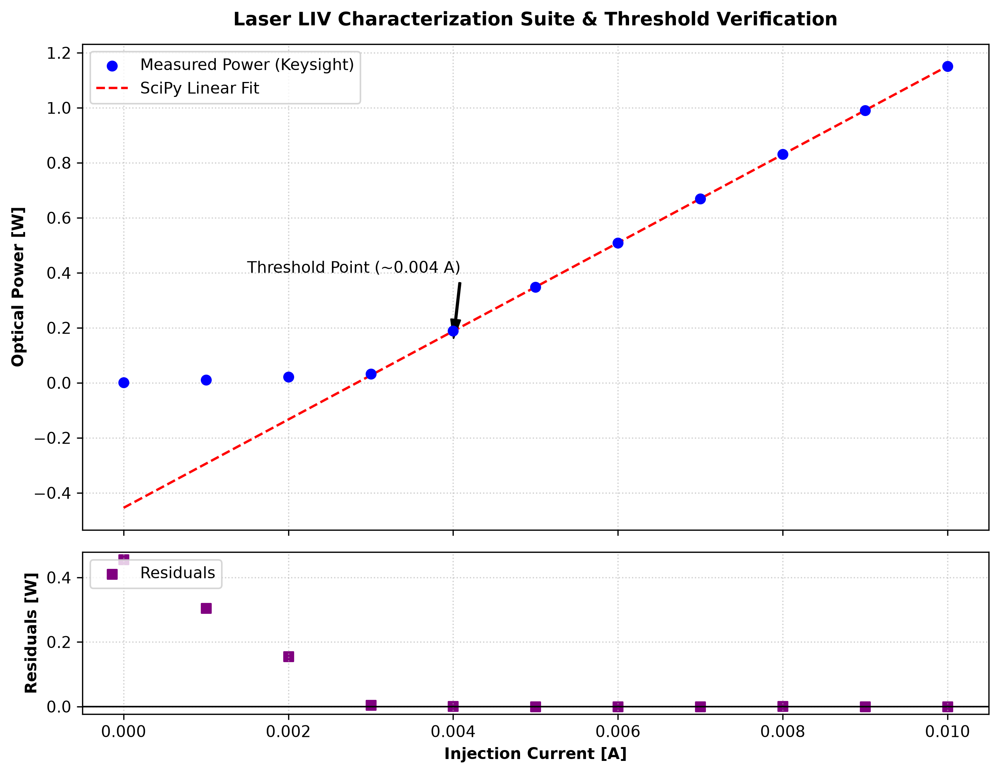

# Multi-Instrument Automated Test Executive & Silicon Telemetry Engine

## Project Overview
This repository hosts the complete, production-grade automated characterization sweep and signal processing framework developed for a **Multi-Instrument Electro-Optical LIV Test Bench**. 

The system synchronizes discrete industrial benchtop instruments via an instrumentation bus utilizing the **PyVISA** driver core and the **SCPI Protocol Standard**. The downstream data pipeline acts as an automated metrology framework, integrating vectorized database purification via **Pandas** and high-precision non-linear regression using **SciPy** to calculate laser diode threshold boundaries and monitor silicon wafer material stability.

---

## Technical Architecture & Operational Phases

### 1. Synchronized Instrument Gating & Current Compliance
The test executive loop manages bidirectional communication links across the instrumentation plane, gating a **Keithley Source Measure Unit (SMU)** as the master sourcing chassis and a **Keysight Power Meter** as the slave optical receiver. To secure sensitive front-end laser architectures from thermal overload, a rigid hardware current compliance threshold is locked programmatically at **100mA** (`SOUR:CURR:PROT 0.1`).

### 2. Isolated Fault Tolerance & Defensive Coding
Built to withstand volatile laboratory environments, the automated driver executes a defensive communication structure. Every write and query transaction is isolated inside localized exception blocks. If an physical bus line collapses mid-sweep (e.g., an over-axis GPIB or LAN dropout), the execution loop:
* Captures and isolates the specific `VisaIOError` or truncation fault locally.
* Prevents runtime thread locks and continuous memory pool corruption.
* Populates the faulty cell with a float `np.nan` structure to preserve database schema dimensions.
* Telemeters a highly descriptive status packet directly into the active tracking register (`status_register`).

### 3. Cascading Safety Shutdown Protocol
To shield the equipment from remaining in high-energy states under general system failure scenarios, the core automation engine wraps the sweep within a global framework. The **`finally` block** overrides all software layers, forcing an immediate cascading hardware teardown: disabling active analog lines instantly (`OUTP OFF`) and closing all open digital resource handles cleanly to eliminate memory leaks within the operating system.

### 4. Vectorized Data Purification & Non-Linear SciPy Regression
Following a safe hardware shutdown, the pipeline ports the telemetry arrays into a **Pandas DataFrame**. The system purges bus dropouts (`.dropna()`), strips negative hardware offset tracking artifacts, and performs vectorized unit conversions in the RAM. 

The purified dataset is then passed to the **SciPy Optimization Engine**, executing a non-linear least-squares fitting algorithm (`curve_fit`) to extract the exact device **Slope Efficiency** parameter and map the standard errors directly from the diagonal elements of the resulting **Covariance Matrix** (`pcov`).

---

## Data Analysis & Visual Outputs
The visualization panel executes deep signal tracing by compiling a synchronized dual-plot layout (`sharex=True`) displaying the master LIV sweep profile alongside an integrated **Residuals Analysis** matrix to detect localized microstructural material failures.

* **Source Code:** `telemetry_purge_engine.py` & `numerical_analysis_plot.py`
* **Core Analytics Graphic:**

---

## Technical Stack & Dependencies
* **Language Environment:** Python 3.x
* **Driver Interface:** PyVISA / NI-VISA Core Backend
* **Data Science Infrastructure:** NumPy (Vectorized coordinate matrices), Pandas (Relational database structures), SciPy (Least-squares mathematical optimization engines)
* **Visualization Layer:** Matplotlib (LaTeX-integrated vector graphics engine deployed at `dpi=300`)
* **Communication Protocol Standard:** IEEE-488.2 / SCPI Architecture
